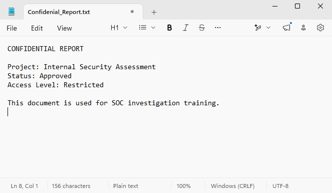
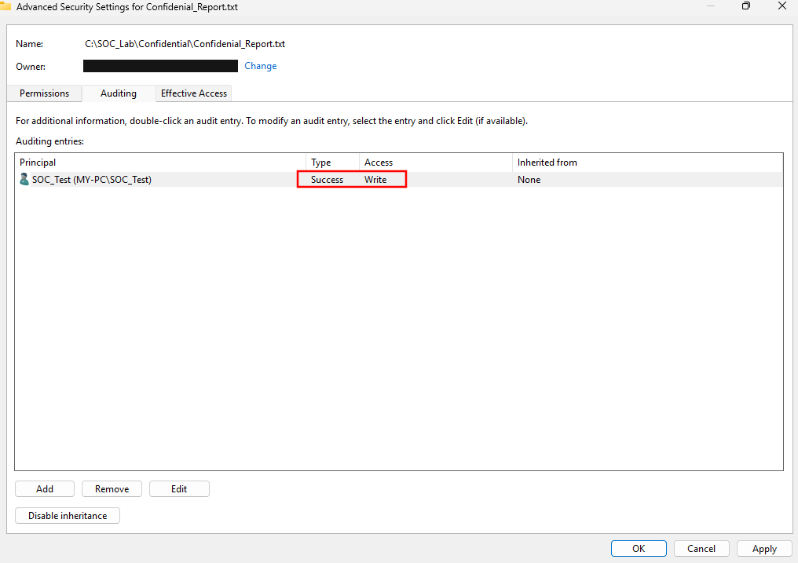
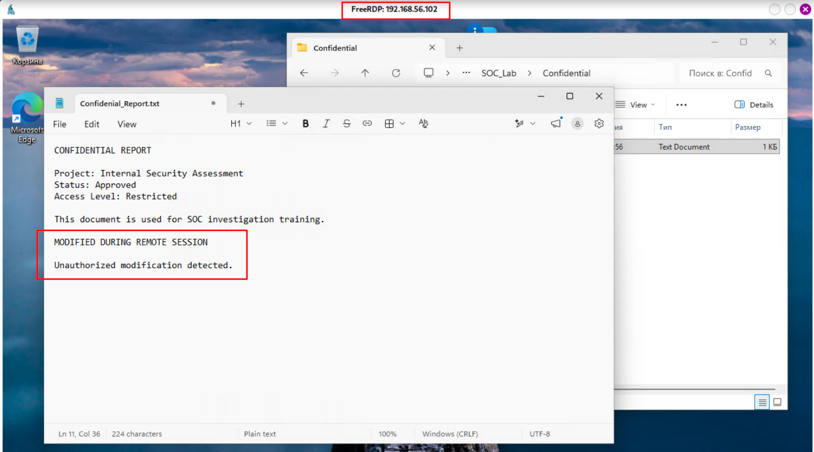
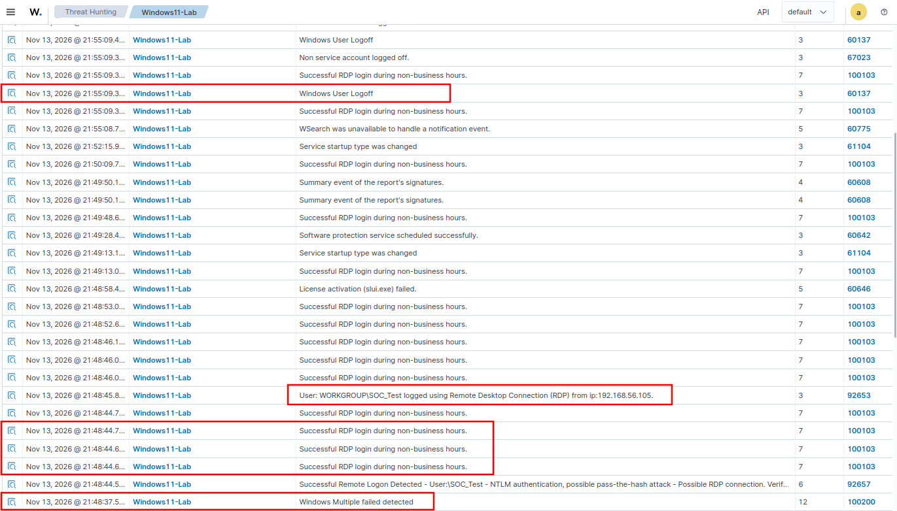
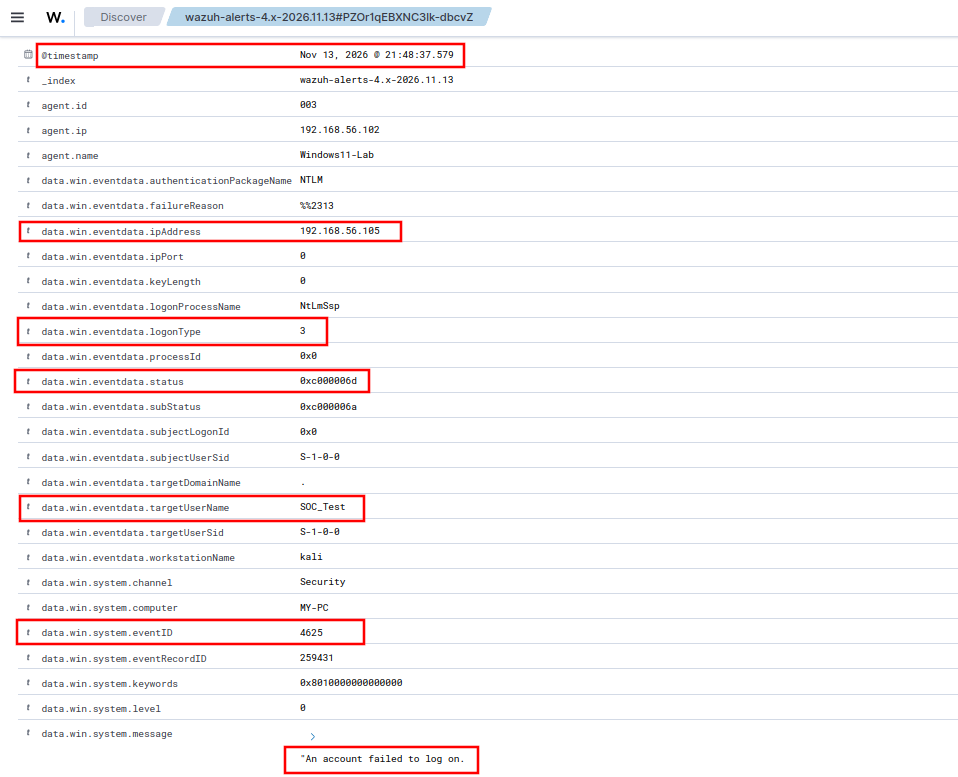
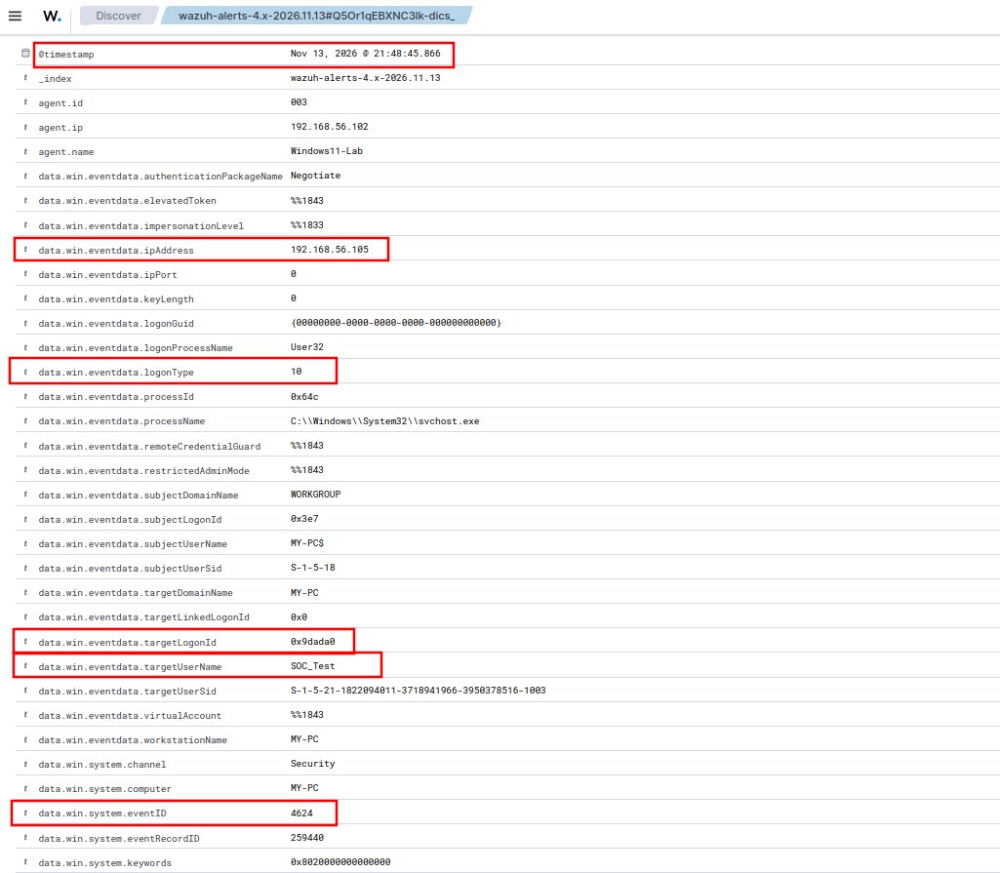
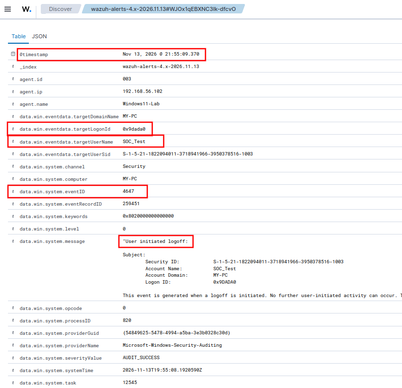
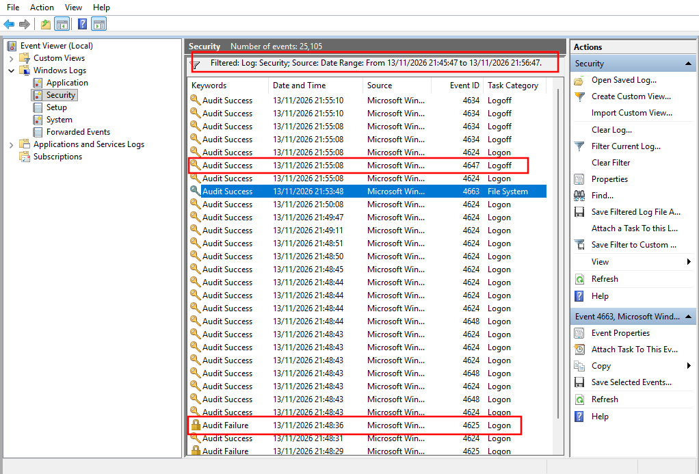
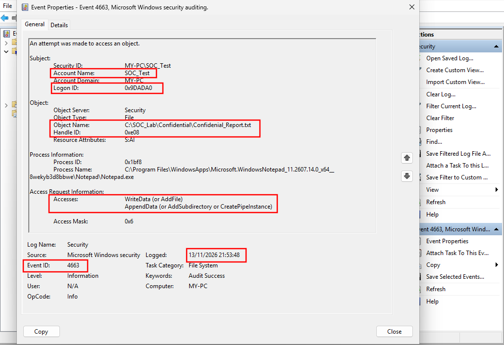

# Windows RDP Security Incident Investigation
### Windows 11 Pro | Kali Linux | Wazuh SIEM

## 1. Project Overview

This project simulates a Windows security incident involving unauthorized remote access through Remote Desktop Protocol (RDP), followed by modification of a sensitive file.

The investigation was conducted from a SOC analyst's perspective using Wazuh SIEM and Windows Security Event Logs.

The objective was to identify the source of the connection, investigate authentication activity, correlate the remote session with file modification, and determine when the session ended.

**Lab Environment:**
- **Target:** Windows 11 Pro
- **Attacker Simulation:** Kali Linux
- **SIEM:** Wazuh
- **Protocol:** Remote Desktop Protocol (RDP)
- **Network:** Isolated VirtualBox lab environment

## 2. Incident Scenario

The simulated incident consisted of the following stages:

1. **Initial Access:** An attacker uses Kali Linux to establish a connection to the Windows 11 machine over RDP.
2. **Failed Authentication:** An unsuccessful authentication attempt is recorded.
3. **Successful Remote Access:** The attacker successfully logs in to Windows using the `SOC_Test` account.
4. **Post-Login Activity:** The attacker accesses and modifies a prepared confidential file.
5. **Session Termination:** The remote Windows session is terminated.
6. **SOC Investigation:** The analyst examines authentication, session, and file access events to reconstruct the incident timeline.

## 3. Lab Preparation

### 3.1. Creating the Confidential File

A dedicated directory was created on the Windows 11 machine:

`C:\SOC_Lab\Confidential`

A file named `Confidential_Report.txt` was created with the following initial content:



### 3.2. Configuring Windows File Auditing

Windows Advanced Audit Policy was configured to monitor file system access.

The following policy was enabled:

`Advanced Audit Policy Configuration → System Audit Policies → Object Access → Audit File System`

Audit setting:
- Success

An auditing entry was configured for the `SOC_Test` account on the confidential directory.

The following permission was selected:
- Write data (for files)

This configuration allowed Windows to generate Security Event ID 4663 when the account accessed the monitored file with the specified permissions.



## 4. Attack Simulation

### 4.1. Verifying RDP Connectivity

From Kali Linux, the target's RDP port was checked using Netcat:

```bash
nc -vz 192.168.56.102 3389
```

The TCP connection was successful, confirming that port 3389 was reachable.

### 4.2. Establishing an RDP Session

The following command was used to connect to Windows:

```bash
xfreerdp3 /v:192.168.56.102 /u:SOC_Test /d:. /cert:ignore +dynamic-resolution +clipboard
```

An unsuccessful authentication attempt was performed, followed by a successful login to the Windows desktop.

### 4.3. Modifying the Confidential File

During the remote session, the attacker accessed:

`C:\SOC_Lab\Confidential\Confidential_Report.txt`

The following text was appended to the original document:



The changes were saved, and the file was closed.

### 4.4. Terminating the Remote Session

The remote session was terminated using:

`Start → User → Sign out`

## 5. SOC Investigation

The investigation started in the Wazuh Dashboard:

`Threat Hunting → Events`

The analyst examined Windows Security Events to reconstruct the authentication and session timeline.

### 5.1. Initial Event Timeline

| Time | Event ID | Description |
|---|---|---|
| 21:48:37 | 4625 | Failed logon attempt |
| 21:48:45 | 4624 | Successful RDP logon |
| 21:55:09 | 4647 | User-initiated logoff |

The successful RDP login occurred outside normal business hours.



### 5.2. Failed Authentication — Event ID 4625

The failed authentication event was examined in Wazuh.

| Field | Value |
|---|---|
| Event ID | 4625 |
| Target User | SOC_Test |
| Source IP | 192.168.56.105 |
| Logon Type | 3 |
| Status | 0xc000006d |

**Analysis:**

The event indicates an unsuccessful Network Logon attempt involving the `SOC_Test` account.

Logon Type 3 represents network authentication. It does not independently confirm a failed RDP interactive logon.

The event was retained as part of the authentication investigation.



### 5.3. Successful RDP Authentication — Event ID 4624

The successful authentication event provided evidence of remote interactive access.

| Field | Value |
|---|---|
| Event ID | 4624 |
| Target User | SOC_Test |
| Logon Type | 10 |
| Source IP | 192.168.56.105 |
| Target Logon ID | 0x9dada0 |

**Analysis:**

Logon Type 10 indicates a RemoteInteractive logon, commonly associated with Remote Desktop Services.

The event confirms that the `SOC_Test` account successfully established an RDP session from the Kali Linux machine.

The Logon ID `0x9dada0` was used as a correlation identifier during the subsequent investigation.



### 5.4. Session Termination — Event ID 4647

The analyst identified the event corresponding to the termination of the user session.

| Field | Value |
|---|---|
| Event ID | 4647 |
| Target User | SOC_Test |
| Target Logon ID | 0x9dada0 |
| Timestamp | 21:55:09 |

**Analysis:**

Event ID 4647 indicates that the user initiated the logoff process.

The matching Logon ID connects this event to the previously identified successful RDP session.

This establishes the end of the investigated user session.



## 6. Additional Investigation — Windows Event Viewer

During the investigation, the analyst identified a telemetry limitation:

**Windows Event ID 4663 was not visible in the Wazuh event results.**

To investigate the file modification, the Windows Security log was examined directly using Event Viewer.

Navigation:

`Win + R → eventvwr.msc → Windows Logs → Security → Filter Current Log`

The time range was restricted to the investigated session (21:45–21:56).

Event ID 4663 was identified in the Windows Security log.

The event occurred between successful authentication and session termination.



### 6.1. File Modification — Event ID 4663

The event details were examined to identify the account, file path, access type, and associated logon session.

| Field | Value |
|---|---|
| Event ID | 4663 |
| Account Name | SOC_Test |
| Logon ID | 0x9dada0 |
| Handle ID | 0xe08 |
| Object Name | C:\SOC_Lab\Confidential\Confidenial_Report.txt |
| Accesses | WriteData (or AddFile) |
| Timestamp | 21:53:48 |

**Analysis:**

Event ID 4663 confirms that the `SOC_Test` account exercised the recorded WriteData permission against the monitored file.

The matching Logon ID (`0x9dada0`) links the file access activity to the previously identified RDP session.

This provides evidence of file modification activity during the remote session.



## 7. Incident Timeline and Correlation

The collected evidence allows the analyst to reconstruct the following sequence:

| Time | Activity | Evidence |
|---|---|---|
| 21:48:37 | Failed network authentication | Event 4625 |
| 21:48:45 | Successful RDP authentication | Event 4624 |
| 21:53:48 | File write access by SOC_Test | Event 4663 |
| 21:55:09 | User-initiated logoff | Event 4647 |

### Correlation Findings

The investigation established the following relationships:

- The source IP address `192.168.56.105` was recorded in the authentication events.
- The `SOC_Test` account successfully established an RDP session.
- Logon Type 10 confirmed RemoteInteractive authentication.
- Event 4663 recorded WriteData access to the monitored file.
- The matching Logon ID `0x9dada0` linked the file access to the RDP session.
- Event 4647 recorded the termination of the same user session.

## 8. SOC Analyst Assessment

**Incident Classification:** Unauthorized Remote Access and File Modification

**Severity:** High (within the simulated lab scenario)

**Investigation Result:** Confirmed simulated incident

The investigation confirmed that the `SOC_Test` account successfully accessed the Windows 11 machine through RDP from the Kali Linux host.

During the remote session, the account performed a write operation on a monitored confidential file.

The following evidence supports this assessment:

1. Event ID 4624 confirmed successful RemoteInteractive authentication (Logon Type 10).
2. The source IP address `192.168.56.105` identified the originating lab host.
3. Event ID 4663 confirmed WriteData access to the confidential file.
4. The matching Logon ID `0x9dada0` correlated the file access with the established RDP session.
5. Event ID 4647 confirmed user-initiated session termination.

An unsuccessful Network Logon attempt (Event ID 4625, Logon Type 3) was also recorded before the successful RDP login. However, the available evidence does not establish that this failed attempt was part of the same RDP authentication sequence.

### Wazuh Telemetry Limitation

A significant finding was that Event ID 4663 was present in the native Windows Security log but was not displayed in the Wazuh Dashboard during the investigation.

Consequently, the file modification could not be independently identified through the available Wazuh event data.

The analyst had to use Windows Event Viewer as an additional investigation source.

This indicates a potential gap in the SIEM telemetry pipeline.

Further investigation should verify:

- Whether Event ID 4663 is collected by the Wazuh agent.
- Whether the relevant Windows Security channel is correctly configured in `ossec.conf`.
- Whether the event is filtered by Wazuh collection settings.
- Whether the event reaches the Wazuh manager and indexer.
- Whether the event is indexed but excluded by the current dashboard query or time filters.

The absence of an event in the Wazuh Dashboard does not necessarily mean that Windows failed to generate it.

## 9. Conclusion

This lab demonstrates how a SOC analyst can investigate a simulated remote access incident by correlating Windows authentication, session, and file access events.

Although Wazuh provided visibility into the authentication and session activity, the absence of Event ID 4663 in the SIEM results highlighted an important limitation in the available telemetry.

By validating the findings directly against Windows Security logs, the analyst was able to establish the connection between the remote RDP session and the modification of the confidential file.

The investigation also demonstrates why SIEM monitoring must be validated against endpoint-level telemetry to ensure that critical security events are collected and available for analysis.

---

**Disclaimer:** This project was conducted in an isolated VirtualBox home lab for educational purposes. All systems, accounts, network addresses, and activities were simulated and controlled.
